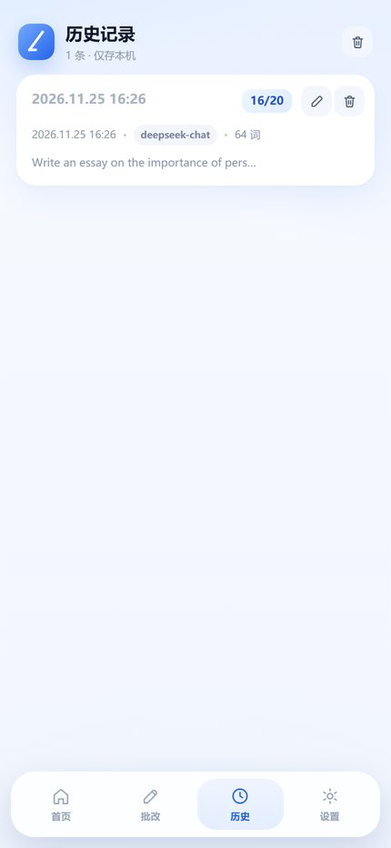
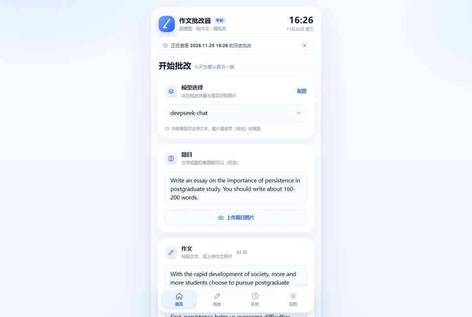

# 作文批改器 · 考研

> 纯前端的考研英语作文 AI 批改工具：选模型、贴作文、得批改。作文、历史、API Key 全部只存在你自己的浏览器里。

| | |
| --- | --- |
| **在线使用** | <https://lulu3103.github.io/composition-correct/> |
| **图文说明书** | <https://lulu3103.github.io/composition-correct/manual.html> |
| **安卓 App** | [下载 APK](https://github.com/LuLu3103/composition-correct/releases/latest) |
| **当前版本** | V6.0（正式版） |
| **技术形态** | 原生 HTML / CSS / JavaScript，无构建、无依赖、无后端 |

> **图片看不到？** GitHub 会把 README 里的图片交给 `raw.githubusercontent.com` 加载，这个域名在国内经常被阻断，所以截图会显示成裂图或一直转圈。这是网络问题，不是文件缺失。同样的内容已发布到 **[在线图文说明书](https://lulu3103.github.io/composition-correct/manual.html)**（图片走 `github.io`，国内可正常打开）。


---

## 一、它能做什么

考研英语作文写完之后，你可以把题目和作文交给 AI 批改：它按你内置的「八段式」提示词，逐条给出修改建议、逐句批改、模板个性化优化、记忆点、积累表达、完整修改稿和评分。

整个过程**不需要注册、不需要登录、没有服务器**：网页是纯静态的，你的作文、历史记录和 API Key 都保存在当前浏览器里，只有批改时才会把作文发给你自己选择的服务商。

适合：备考考研英语一/二的学生，想快速知道自己作文哪里扣分、怎么改、能拿几分。

---

## 二、界面一览

| 首页 | 批改结果 |
| --- | --- |
|  |  |

| 历史记录 | 设置 |
| --- | --- |
|  |  |

桌面浏览器打开时会居中显示为手机宽度，方便对照手机端效果：



---

## 三、快速开始（约 3 分钟）

1. 打开 <https://lulu3103.github.io/composition-correct/>。
2. 进入 **设置** → 选择服务商 → 填写 **API Key** → 点 **保存配置**。
3. 点 **获取可用模型**，勾选要用的模型加入列表（没有列表就手动填模型名）。
4. 回到 **首页**：选模型，填题目和作文（文字或图片都可以）。
5. 点 **提交批改**，结果会显示在「批改」页，同时自动存进「历史」。

> 第一次使用必须先在设置里配置 API Key，否则提交时会提示去设置。

---

## 四、功能详解

### 4.1 首页


- **标题栏**：Logo、应用名、实时时间与日期。
- **模型选择**：下拉选择当前服务商的模型；卡片上会提示当前模型是否支持图片识别（带「视觉」标记的模型才能读图片）。
- **题目**：可以输入文字，也可以「上传题目图片」（最多 3 张）；两者可同时存在，模型会优先按图片中的要求理解题目。
- **作文**：粘贴文本，或拍照 / 从图库上传作文图片（最多 3 张）。
- **提交批改**：一键提交；提交后会自动跳到「批改」页并实时显示模型返回的内容。

### 4.2 批改结果


结果按三大章节组织：**修改建议**、**修改作文**、**作文评分**。每一张卡片都可以折叠：

- 默认展开「总体评价」和「得分详情」，其余收起；
- 收起时右侧显示一行摘要（例如逐句批改显示第一条原句）；
- 顶部 **全部展开 / 全部收起** 一键切换；
- 报告头部直接显示题目、模型、时间与总分。

展开「逐句批改」可以看到原始的对照格式：


点击「全部展开」后是完整报告：


卡片内容说明：

| 卡片 | 内容 |
| --- | --- |
| 题目要求与完成情况 | 是否完成任务、是否偏题、字数、文体 |
| 总体评价 | 当前水平、优点、最影响分数的 2–3 个问题 |
| 逐句批改 | 有问题的句子：原句 → 改为 → 说明 |
| 个性化优化 | 在模板基础上可以补充的表达、位置与作用 |
| 最值得记住的错误 | 3–5 条可迁移的记忆点 |
| 最值得积累的表达 | 表达 + 可用于什么场景 |
| 修改后的完整作文 | 保留原结构、可直接参考的修改稿，可一键复制 |
| 得分详情 | 总分环形图、档次、预估区间、得分优势、主要扣分点 |
| 原始作文 | 提交时的文字或图片 |

底部还有 **复制全文** 和 **重新批改**。

### 4.3 历史记录


- 每次批改自动保存，默认以批改时间命名，可重命名（点铅笔图标）。
- 每条显示时间、使用模型、字数与得分；可单独删除或一键清空。
- 点任意一条，会同时把题目和作文回填到首页，并在批改页还原当时的批改结果。

### 4.4 设置


配置完成后，「服务商与模型」会自动收起，只显示当前服务商、模型和配置状态，点一下展开编辑。

- **服务商**：内置 DeepSeek、OpenAI、通义千问、智谱 GLM、Kimi、硅基流动；可「+ 新建自定义」保存多套自建接口（名称 / 接口地址 / Key）。
- **每个服务商独立保存**自己的地址、Key 和模型列表，切换时互不覆盖；改动后需点「保存配置」才生效，未保存会有提示。
- **获取可用模型**：从服务商的 `/models` 接口拉取真实列表，支持搜索、勾选多个、自动标注视觉模型；也可手动添加模型名。


- **提示词**：可编辑，也可一键恢复默认。
- **数据**：导出 / 导入 JSON 备份、清空本地数据。
- **关于**：使用说明、网站声明、版本号。

### 4.5 图片批改

- 题目和作文都支持图片，各自最多 3 张，图片会先压缩（长边 ≤ 1400px）。
- 只有带「视觉」标记的模型会读取图片；在模型列表里点「文本 / 视觉」标签即可切换。
- 浏览器无法解码 HEIC/HEIF 时会提示改用拍照或转成 JPG。

---

## 五、数据与隐私（安全说明）

这是本项目的核心设计：**没有服务器，没有账号，没有统计**。

**数据存在哪里**

- 作文、批改结果、历史记录、服务商配置与 API Key，全部保存在浏览器的 **localStorage**（键名以 `essayGrader.` 开头）。
- 页面不写 Cookie、不使用第三方存储、不做任何埋点。

**API Key 去哪里**

- Key 只保存在你本机；**不会上传到本项目的任何地方**（本项目也没有可以上传的服务器）。
- 提交批改或拉取模型时，Key 只作为 `Authorization: Bearer <你的 Key>` 请求头，直接发送到**你自己在设置里填写的接口地址**。
- 导出备份默认**剔除 Key**；只有你主动选择「含 Key」时才会写进备份文件。

**页面加载了什么**

- 全部脚本、样式、图标都在仓库内，无 CDN、无第三方脚本、无外部字体、无统计 SDK。
- 整站通过 HTTPS 访问；批改请求同样走 HTTPS（HTTP 接口会被浏览器按混合内容策略拦截）。

**已知边界（请务必了解）**

- 能直接使用你设备或浏览器的人（或拥有你浏览器权限的扩展）可以读取 localStorage 中的 Key；公共电脑上用完请点「清空本地数据」。
- 网站是公开的，但每个人的数据只存在各自的浏览器里，互不可见。
- 不要分享选择了「含 Key」的备份文件。
- 页面本身不含 XSS 注入点（用户内容与图片 URL 均做了转义），但请保持使用官方地址访问。

---

## 六、常见问题

| 问题 | 说明 |
| --- | --- |
| 提示「网络连接失败」 | 服务商不允许浏览器跨域（CORS），或地址 / 网络异常；换一家支持 CORS 的服务商即可 |
| 「获取可用模型」报错 | 该服务商未开放 `/models` 接口，用「手动添加模型名称」即可 |
| 「测试连接」失败但批改能用 | 已做兼容：测试请求被模型拒绝时会改用 `/models` 验证地址与 Key，并给出结论 |
| 图片识别不到文字 | 当前模型不支持视觉，换带「视觉」标记的模型 |
| 图片上传失败 | 可能是 HEIC 格式；改用拍照或先转 JPG，单张上限 30MB |
| 评分没有显示 | 检查是否被截断（页面会提示「长度上限」）；或换输出更长的模型重试 |
| 换设备后数据没了 | 数据只在本机，请用「导出备份 / 导入备份」迁移 |
| 切换服务商后配置乱了 | V3 起每个服务商独立保存，V6 起配置完成后会自动收起 |

---

## 七、安装与使用

### 网页版

直接用手机或电脑浏览器打开 <https://lulu3103.github.io/composition-correct/>。

### 安装到手机主屏幕（PWA）

- iPhone：Safari 打开 → 分享 → 「添加到主屏幕」。
- Android：Chrome 打开 → 菜单 → 「安装应用 / 添加到主屏幕」。

安装后是全屏启动，界面与浏览器一致。

### 安卓 APK

在 [Releases](https://github.com/LuLu3103/composition-correct/releases/latest) 下载 `composition-correct-v6.0.apk`，安装时允许「安装未知来源应用」即可。

- APK 内置了网页资源，**离线也能打开界面**；批改时仍需联网访问你配置的服务商。
- 通过自签名证书打包（非应用商店分发），首次安装需要手动允许。

---

## 八、技术说明

- 单页应用，原生 ES Module，无构建步骤、无 npm 依赖。
- 结果解析兼容多种模型输出：八段编号、三段括号、Markdown 加粗、表格、无冒号、区间分等写法。
- 批改请求使用 SSE 流式输出，长回答可实时看到进度。
- PWA：`manifest.webmanifest` + `sw.js`，离线壳缓存；版本号同时写在 `store.js`（APP_VERSION）与 `sw.js`（VERSION）。

目录结构：

```
.
├── index.html               # 单页外壳
├── manifest.webmanifest     # PWA 清单
├── sw.js                    # 离线缓存
├── assets/
│   ├── css/app.css          # 全部样式
│   ├── icons/               # 图标
│   └── js/
│       ├── app.js           # 路由与批改任务
│       ├── api.js           # OpenAI 兼容接口 / SSE / 模型列表
│       ├── parse.js         # 八段解析与评分抽取
│       ├── prompt.js        # 默认提示词
│       ├── store.js         # 本地存储与多服务商配置
│       ├── utils.js         # DOM / Markdown / 图片压缩
│       └── views/           # 首页 / 批改 / 历史 / 设置
├── docs/images/             # 说明书配图
├── manual.html              # 在线图文说明书（由 README 生成）
└── tools/                   # 图标生成、发布脚本、README → manual.html
```

浏览器要求：支持 ES Module 与 `fetch` 的现代浏览器（Chrome / Edge / Safari / Firefox 近两年版本）。

---

## 九、开发与部署

本地预览（无需构建）：

```bash
python -m http.server 8123
# 浏览器打开 http://127.0.0.1:8123
```

发布到 GitHub Pages：

- 推送到 `main` 分支，仓库 Settings → Pages 选择 `main / (root)`；
- 若本机 `git push` 不稳定，可用 GitHub API 发布：

```bash
python tools/deploy.py --dry-run
python tools/deploy.py
```

发版时记得同步修改 `assets/js/store.js` 的 `APP_VERSION` 和 `sw.js` 的 `VERSION`，否则浏览器可能继续使用旧的离线缓存。

---

## 十、更新日志

### V6.0（2026-11-25 · 正式版）
- 修复图片提交时评分识别不到：兼容加粗 / 表格 / 无冒号 / 区间分等写法，评分段缺失时回退全文查找。
- 输出被截断时给出提示卡片。
- 设置页「服务商与模型」可折叠，配置完成后自动收起。

### V5.0（2026-11-25 · 正式版）
- 题目支持图片；修复图库上传兼容性（空 MIME / octet-stream / HEIC 提示）。

### V4.0（2026-11-25）
- 批改结果卡片可折叠，新增全部展开 / 收起。
- 修复设置页事件重复绑定导致的模型列表串台、测试连接误报。

### V3.0（2026-11-25）
- 多服务商配置：下拉切换、独立保存、多套自定义服务商。

### V2.0（2026-11-25）
- 模型列表改为从服务商获取；提示词换成八段式，批改页按八段呈现。

### V1.0.0（2026-11-25）
- 首个版本：四页结构、文本/图片批改、流式输出、历史、本地设置与备份、PWA。

---

## 十一、免责声明

AI 批改结果仅供学习参考，不代表真实考试评分。因使用本工具产生的任何后果由使用者自行承担；请遵守你所使用 AI 服务商的服务条款。
